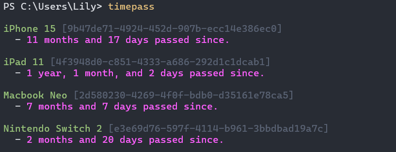

# TimePass

Track how long you've owned your stuff for!

>[!NOTE]
>TimePass saves it's data in the following directories <br>
>Windows: C:\Users\xxx\AppData\Roaming\timepass <br>
>Linux:   /home/xxx/.config/timepass <br>
>macOS:   /Users/xxx/Library/Application Support/timepass

## Showcase


## Usage
```
Usage: timepass.exe [OPTIONS] [COMMAND]

Commands:
  add     Add a new entry to the system
  data    Options for importing or exporting data
  remove  Remove an entry using either Name or ID
  help    Print this message or the help of the given subcommand(s)

Options:
  -n, --name <NAME>  Show specific entry via name.
  -i, --id <ID>      Show specific entry via ID.
  -h, --help         Print help
```

## Compiling
To build the app, you will need rustup, and git.

You can download rust up [here.](https://rustup.rs/)

Next, you will need git.
``` bash
# Windows
winget install --id Git.Git

# Macos
xcode-select --install

# Linux
## Ubuntu
sudo apt install git

## Fedora/OpenSUSE
sudo dnf/zipper in git

## Arch
sudo pacman -S git # No way you don't already have it installed LOL
```

Now, we can clone into the repository and compile.
```bash
git clone https://github.com/hexedrevii/timepass.rs
cd timepass/
```

Rust has a very nice package manager, all you need to do is run one command then move it into PATH.
```bash
cargo build --release

# Linux/MacOS
sudo mv ./target/release/timepass /usr/local/bin

# Windows
# For windows, you will need to create a directory, e.g. C:\Users\xxx\Binaries
mv .\target\release\timepass.exe C:\Users\xxx\Binaries
# Afterwards, open explorer.exe > This PC > right click > properties >
# Advanced System Settings > Environment Variables >
# double-click PATH > click New > paste the path > restart shell

# Once the shell has been restarted, you can now use timepass from anywhere.
```

## LICENSE
GPL 3.0
